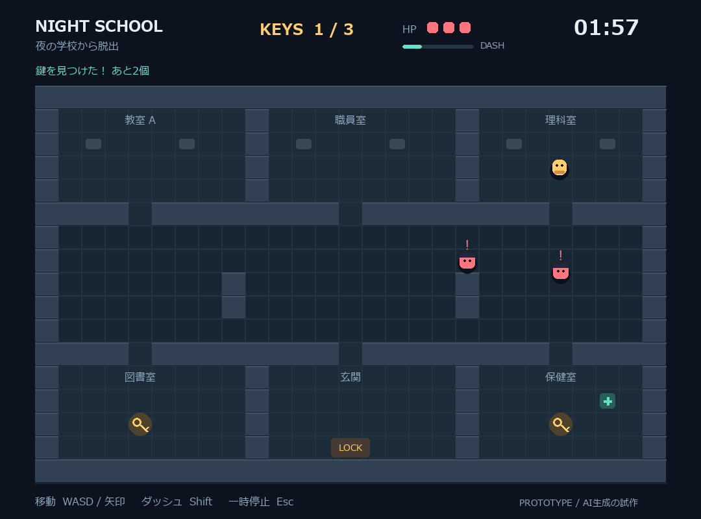

# 夜の学校から脱出 - School Escape Demo

プロジェクト演習II・第13グループでゲーム案を検討するための、遊べる参考用プロトタイプです。
**CodexによるAI生成の試作品です。正式なグループ成果物や、個人が実装した追加機能を示すものではありません。**



## どんなゲーム？

120秒以内に学校の中にある鍵を3つ集め、下中央の玄関から脱出する見下ろし型ゲームです。
見回り役を避け、必要なときはダッシュで逃げましょう。

- 鍵：触れると自動で取得。3つ集めると出口を開けられます。
- 見回り役：紫色で巡回し、壁に遮られず近くのプレイヤーを見つけると赤くなって追跡します。
- HP：最初は3。接触で1減り、3秒間は再被弾しません。接触した敵は1秒停止します。
- 回復：保健室の「＋」で、HPを一度だけ1回復できます。
- ダッシュ：スタミナを消費。使い切ったら30%まで回復する間は使用できません。
- 失敗条件：時間切れ、またはHPが0。
- 机は背景の飾りです。壁が通行を妨げます。

## 動かし方

確認環境は **Python 3.13.12 / Pygame 2.6.1** です。Python 3.13を推奨します。
画像・音声の追加ダウンロードは不要です。日本語表示にはメイリオ等の日本語フォントが必要です。

### Windows

GitHubの緑色の **Code → Download ZIP** からダウンロードし、ZIPを展開します。
展開先のフォルダでターミナルを開き、以下を実行してください。

```powershell
py -3.13 -m venv .venv
.\.venv\Scripts\python.exe -m pip install -r requirements.txt
.\.venv\Scripts\python.exe game.py
```

初回設定後は `run_game.cmd` のダブルクリックでも起動できます。
この起動ファイルは、このフォルダの `.venv` を使用します。

### macOS / Linux

Pygame 2.6.1が利用できるPython環境で、以下を実行してください。
こちらの環境では未検証です。

```sh
python3 -m venv .venv
.venv/bin/python -m pip install -r requirements.txt
.venv/bin/python game.py
```

## 操作

| 操作 | キー |
|---|---|
| ゲーム開始 | Enter / 開始ボタン |
| 移動 | WASD / 矢印キー |
| ダッシュ | Shift |
| 一時停止・再開 | Esc |
| 再挑戦 | 結果画面でR / Enter / ボタン |
| 終了 | ウィンドウの×。タイトル・結果画面ではEscも使用可 |

別のウィンドウへ切り替えると自動で一時停止します。

## ファイルと編集箇所

| ファイル | 役割 |
|---|---|
| `game.py` | ゲーム本体。マップ・敵・ルール・画面をまとめています |
| `requirements.txt` | 必要なPygameのバージョン |
| `run_game.cmd` | Windows向けの起動ファイル |
| `preview_play.png` | 紹介用の画面画像 |

`game.py` の主な構成：

- `make_map` / `GRID`：学校の壁・部屋・通路
- `KEY_CELLS` / `EXIT_CELL` / `START_CELL`：鍵・出口・開始位置
- `find_path` / `visible`：経路探索・視界判定
- `Guard`：巡回と追跡
- `Game.reset`：初期化・再挑戦
- `Game.update`：移動、アイテム、被弾、勝敗
- `Game.draw_map` / `draw`：マップ・表示・タイトル・結果画面

## 確認したこと

移動と壁の衝突、鍵の取得、敵の経路、HPと無敵時間、回復、時間切れ、クリア、
一時停止、再挑戦の初期化を自動確認しました。
敵を有効にした模擬操作で、鍵3個を集めて脱出できることを確認しています。
難易度は仮調整なので、実際に遊んで感想を出してください。

## グループで相談したいこと

- 敵の速さやダッシュの強さはちょうどよいか？
- 鍵のランダム配置、懐中電灯、隠れ場所などを追加するか？
- 正式に採用する場合、共通ベースと各自の担当機能をどう分けるか？

正式な共同開発リポジトリ：<https://github.com/kusupon/ProjExD_Group13>
この参考用リポジトリから正式な開発先へ自動で同期されることはありません。
